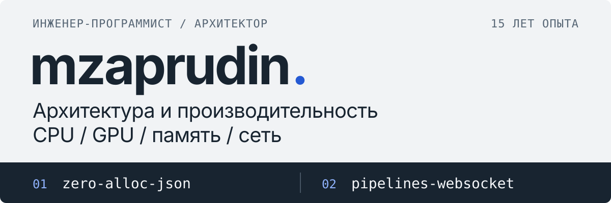

<a href="https://github.com/mzaprudin/.github/blob/main/profile/README.md">English</a> · <strong>Русский</strong>

<h1></h1>

Проектирую **системы реального времени и компоненты с низкими задержками** для обработки высокочастотных потоков данных и решаю исследовательские задачи.

Самостоятельно веду полный цикл разработки: ставлю задачу, выбираю архитектуру, оптимизирую **CPU/GPU, память и сеть**, настраиваю мониторинг. Работаю по принципу **AI-first**: использую LLM и кодогенерацию для исследований, разработки и освоения новых языков и предметных областей.

## Примеры инженерных решений

В таблице — отдельные программные компоненты и эксперименты с конкретными инженерными решениями, а также любительские разработки с устройствами.

| Репо&shy;зиторий | Назначение, решения и примеры |
|---|---|
| **01** · [zero-alloc-json](https://github.com/mzaprudin/zero-alloc-json) | **Zero-allocation обработка JSON** на C#/.NET для систем с низкими задержками. Оптимизированный парсинг и переиспользование объектов и буферов снижают нагрузку на GC, помогая сохранять предсказуемое время обработки непрерывного потока данных. Ускорение относительно System.Text.Json в бенчмарках: **до 1,34× на запись и до 1,23× на парсинг**. [Бенчмарки](https://github.com/mzaprudin/zero-alloc-json/blob/main/README.ru.md#бенчмарки-json-и-маршрутизации) · [Пример](https://github.com/mzaprudin/zero-alloc-json/tree/main/samples/ZeroAlloc.Json.Demo) |
| **02** · [pipelines-websocket](https://github.com/mzaprudin/pipelines-websocket) | **Zero-allocation приём WebSocket** на TCP/TLS и Pipelines для непрерывных потоков данных. Обработчик читает нефрагментированные сообщения прямо из памяти пула, снижая нагрузку на GC. Практически нулевые аллокации: **до 160 раз меньше** выделяемой памяти, чем у ClientWebSocket, в зависимости от сценария. [Измерения по Ethernet](https://github.com/mzaprudin/pipelines-websocket/blob/main/README.ru.md#websocket-по-физической-сети-ethernet) · [Примеры клиентов](https://github.com/mzaprudin/pipelines-websocket/tree/main/samples/Pipelines.WebSockets.Demo) |
| **03** · [gpu-hyperparam-scheduler](https://github.com/mzaprudin/gpu-hyperparam-scheduler) | **Параллельный подбор гиперпараметров на GPU** для сравнения конфигураций модели без ручного управления экспериментами. Новые варианты выбираются с учётом прошлых результатов; история сохраняется для продолжения поиска. [CPU-пример и результаты](https://github.com/mzaprudin/gpu-hyperparam-scheduler/blob/main/examples/README.RU.md) |
| **04** · [AirWireCom](https://github.com/mzaprudin/AirWireCom) | Беспроводной UART поверх ESP-NOW для связи компьютера с удалённым устройством. **Синхронизация скорости**: удалённая плата автоматически подстраивается под скорость порта на компьютере. [Подключение и сопряжение](https://github.com/mzaprudin/AirWireCom/blob/main/README.RU.md#как-это-работает) |
| **05** · [DialScroll](https://github.com/mzaprudin/DialScroll) | Прошивка беспроводного колеса на nRF52840 и MT6701: **круговая фильтрация угла**, накопление малых движений, адаптивный опрос и BLE HID. [CAD корпуса и анимация](https://github.com/mzaprudin/DialScroll/blob/main/README.RU.md#корпус) |
| **06** · [RFIDHunter](https://github.com/mzaprudin/RFIDHunter) | Android-приложение для поиска вещей с отдельным Bluetooth UHF RFID-считывателем: **выбор метки по силе сигнала**, адаптивное определение речи, офлайн-распознавание Vosk и транзакционная очередь резервного копирования. [Сценарии с mock-ридером](https://github.com/mzaprudin/RFIDHunter/blob/main/docs/DEVELOPMENT.RU.md#маршрут-mock) |
| **07** · [FilamentDryer](https://github.com/mzaprudin/FilamentDryer) | Прошивка сушилки филамента на ESP32: **оценка выделения влаги**, каскадное управление температурой и импульсная вентиляция. Вентиляторы включаются перед нагревом. [Модель и разводка платы](https://github.com/mzaprudin/FilamentDryer/blob/main/README.RU.md#печатная-плата) |
| **08** · [notiprint](https://github.com/mzaprudin/notiprint) | Печать Android-уведомлений по Bluetooth: **сохраняемая очередь Room**, повторные попытки и восстановление заданий. Кириллица выводится растровым ESC/POS. [Проверки](https://github.com/mzaprudin/notiprint/blob/main/README.RU.md#проверки) |
